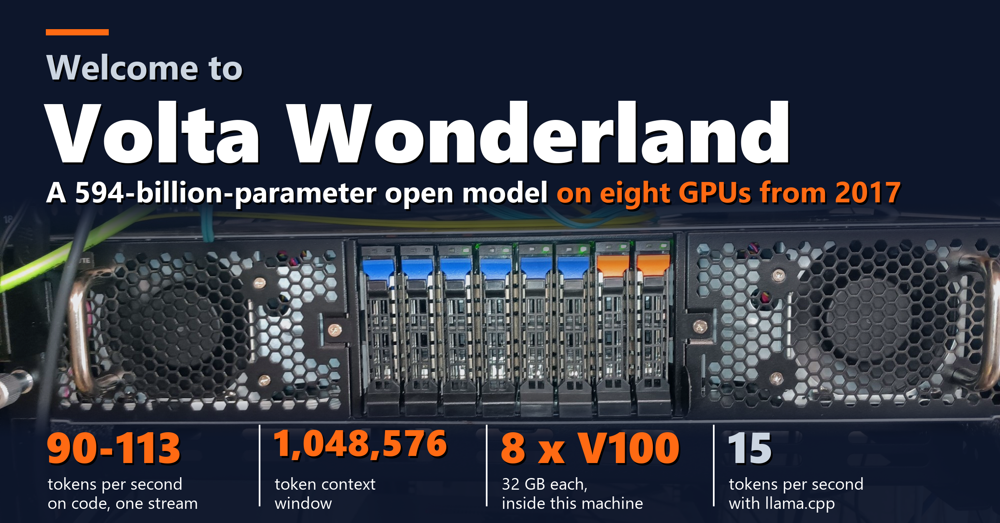
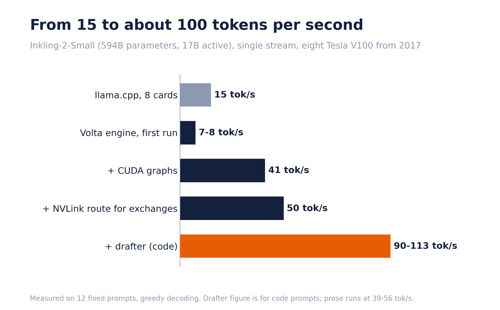
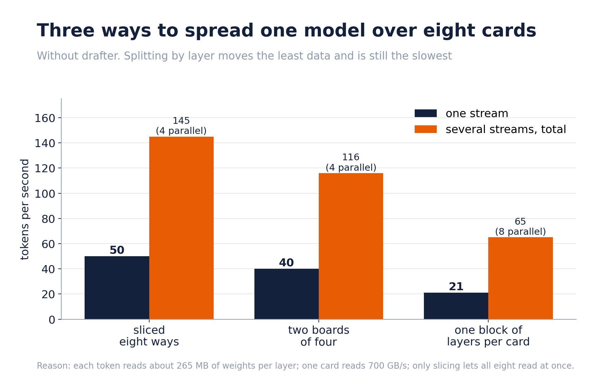
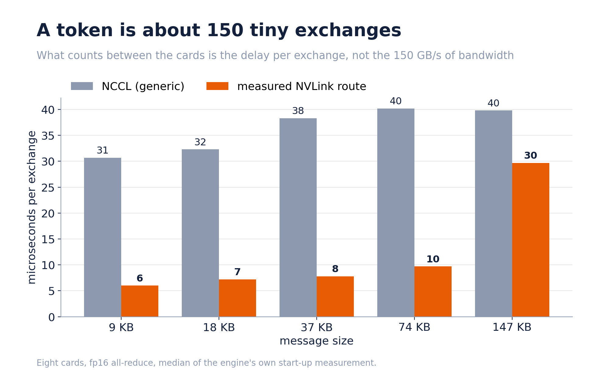
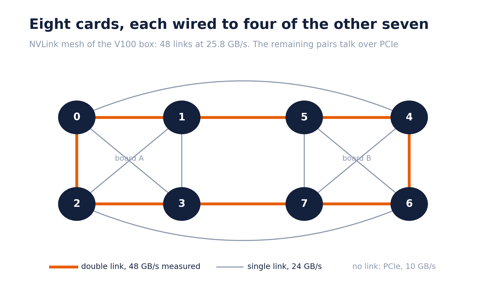

# Welcome to Volta Wonderland
### Inkling-2-Small on 8x Tesla V100

**A 594-billion-parameter open model on eight GPUs from 2017.**

This repository documents how Inkling-2-Small (594B parameters in total, 17B active per token) was brought up on
eight Tesla V100-SXM2-32GB cards, inside a Volta build of vLLM, at a speed that makes it usable as a coding
assistant. It contains the paper, every measurement script, the engine patches and the launch scripts.

## Results

| | Measured |
|---|---|
| Code generation, one stream, with draft model | 90-113 tok/s, log windows up to 136 |
| Prose generation, one stream, with draft model | 39-56 tok/s |
| Without draft model, one stream | about 50 tok/s |
| Without draft model, four parallel requests | up to 145 tok/s in total |
| llama.cpp, same file, same cards | 15 tok/s |
| Context window | 1,048,576 tokens |
| Longest retrieval test passed so far | 56,149 tokens |
| Prompt intake | about 300 tok/s on long prompts, up to about 1,350 on short turns |
| Coding bench, 16 executed tasks, 2-bit weights, thinking off | 13 of 16 |

**What is not solved.** Prompt intake is slow: a full 1M-token prompt would take close to an hour. Memory at the
1M setting is at the edge of the cards. The draft model does not yet work properly in the two-board layout. These
are listed in the paper under open work.

## What the paper covers

1. The hardware: what a V100 can and cannot do, the NVLink mesh, the measured memory read speed.
2. Getting a 2-bit quantised mixture-of-experts model into the engine: dense weights, experts kept in their codec.
3. Whether 2-bit weights are still good enough, tested with executed coding tasks and exact-recall tables.
4. Three ways of spreading one model over eight cards, built and measured, and why the intuitive argument for each
   was wrong in at least one respect.
5. The draft model and the 1M-token context.
6. The wrong turns, written down as lessons.

Read it here: [paper/welcome-to-volta-wonderland.md](paper/welcome-to-volta-wonderland.md)

## Layout of this repository

| Folder | Content |
|---|---|
| `paper/` | The paper |
| `figures/` | Figures and the script that draws them from the measured numbers |
| `scripts/` | Everything that runs on the machine: download, conversion, benchmarks, probes, start scripts |
| `scripts/engine-patch/` | The changes to the engine's Inkling model: experts in GGUF codec, split by layer, draft features across the hand-off |
| `scripts/coder/` | Start, stop and status scripts and the OpenCode configuration |
| `desktop/` | Windows wrapper that opens OpenCode on a workstation against the model over an SSH tunnel |
| `results/` | Recorded answers of the reference prompts and the coding and recall probes |
| `docs/lab-notes.md` | The working log with every measurement in the order it was taken |

## Built on other people's work

None of this would exist without:

- **vLLM** and the **1Cat-vLLM** Volta build of it, including its Inkling-2-Mini port (pull request 1616), its
  codec-native GGUF operators, its measured all-reduce planner and its draft-model runner. This repository contains
  patches on top of that engine, not the engine.
- **Thinking Machines** for Inkling-2 and its bundled draft model.
- **Unsloth** for the 2-bit GGUF quantisation of Inkling-2-Small.
- **llama.cpp**, used here as the reference implementation and measuring stick.
- **OpenCode** as the coding interface.

## Reproduction

The scripts assume the layout described at the top of `scripts/ink2-env.sh`. In short:

1. Build the engine from the pull request with `scripts/build-engine.sh`.
2. Download the GGUF and the base files with `scripts/download2.sh`.
3. Extract the dense weights with `scripts/ink2-namemap.py` and `scripts/ink2-dense-extract.py`.
4. Apply the patches in `scripts/engine-patch/` (`apply.py`, then `apply_pp.py`, then `apply_pp_aux.py`).
5. Start with `scripts/small-draft-start.sh` (8K context) or `scripts/small-1m-start.sh` (1M context).

Paths and addresses in the scripts are those of one particular machine and need adjusting.

## Licence

This repository is released under the GNU General Public License v3.0 (see `LICENSE`). The engine the patches
apply to, and vLLM itself, are Apache-2.0 projects and keep their own licence.
